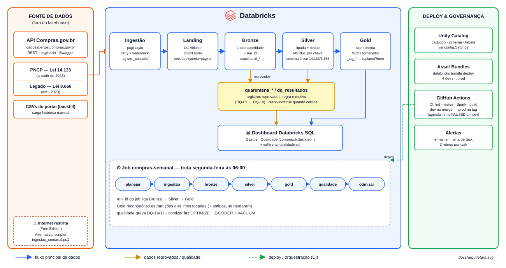

# 🏛️ Lakehouse de Compras Públicas Federais

**Dados abertos do governo, do JSON bruto ao star schema confiável, toda semana, sem intervenção.**

> **Stack:** Python 3.12 · PySpark · Delta Lake · Databricks Free Edition (serverless) ·
> Unity Catalog · Asset Bundles · GitHub Actions
> **Fonte:** [API de Dados Abertos do Compras.gov.br](https://dadosabertos.compras.gov.br/swagger-ui/index.html)
> (Lei 14.133 via PNCP e Lei 8.666 via Legado), mais a [API do PNCP](https://pncp.gov.br/api/pncp/swagger-ui/index.html)
> para o código do catálogo dos itens

---

## 🧭 O problema

O governo federal publica tudo o que compra: licitações, itens, contratos e fornecedores. Os
dados são abertos, mas **não estão prontos para análise**:

- vêm de **duas leis com APIs diferentes** (14.133 no PNCP e 8.666 no Legado), com campos e
  formatos distintos para a mesma coisa;
- chegam **paginados, por órgão e por modalidade**, exigindo milhares de chamadas;
- trazem **registros inválidos** (CNPJ com dígito errado, valor negativo, contrato que termina
  antes de começar);
- **contratos aparecem com meses de atraso**, então uma carga só do dia anterior quase sempre
  vem vazia;
- o cadastro de fornecedores **muda com o tempo** (razão social, porte, endereço), e sem
  histórico não dá para saber como a empresa era na data da compra.

Este projeto resolve isso com um pipeline batch **semanal, incremental e idempotente**, que
responde perguntas como:

| # | Pergunta | Onde responde |
| --- | --- | --- |
| 1 | Quais órgãos mais gastam, por mês? | `fato_compras` + `dim_orgao` |
| 2 | Quais fornecedores receberam mais em contratos? | `fato_contratos` + `dim_fornecedor` |
| 3 | Quais itens são mais comprados, em quantidade e valor? | `fato_compras` + `dim_item` |
| 4 | Como o gasto evolui mês a mês? | `fato_compras` + `dim_data` |
| 5 | Quais modalidades (pregão, dispensa…) concentram o volume? | `fato_compras` + `dim_modalidade` |

---

## 📖 Glossário de bolso

| Termo | O que é |
| --- | --- |
| **UASG** | Unidade administrativa que faz a compra. É o "órgão" no nível mais fino |
| **CATMAT / CATSER** | Catálogos oficiais de materiais e serviços; identificam o item comprado |
| **PNCP** | Portal Nacional de Contratações Públicas, a fonte das compras pela Lei 14.133 |
| **Legado** | Sistema das compras pela Lei 8.666, com dados até ~2023 |
| **Modalidade** | Forma da compra: pregão, concorrência, dispensa, inexigibilidade… |
| **Medalhão** | Organização em camadas: Bronze (bruto), Silver (limpo) e Gold (modelo de análise) |
| **Landing** | Pasta no UC Volume onde o JSON da API chega antes da Bronze |
| **Janela** | Um dia de dados da fonte. O run semanal processa as janelas desde o último run |
| **Watermark** | Marca da última janela processada com sucesso; é dela que o próximo run continua |
| **Fan-out** | Uma chamada por órgão, modalidade ou CNPJ, quando a API exige esse filtro |
| **Quarentena** | Tabela onde ficam os registros reprovados, com a regra e o motivo |
| **Surrogate key (sk)** | Chave numérica da dimensão. `-1` é o membro "desconhecido" |
| **SCD tipo 2** | Dimensão que guarda o histórico: cada mudança cadastral vira uma nova versão |
| **Idempotente** | Rodar de novo a mesma janela dá o mesmo resultado, sem duplicar nada |

---

## 💼 Vantagens

| Sem o lakehouse | Com o lakehouse | Ganho |
| --- | --- | --- |
| Baixar e juntar JSON de duas APIs na mão | Um job semanal agendado faz tudo | Zero trabalho manual |
| Campos diferentes para 14.133 e 8.666 | Schema único na Silver, com prioridade para o PNCP | Uma consulta cobre as duas leis |
| Registro ruim some ou contamina o total | Quarentena com regra e motivo; reconciliação Silver ↔ Gold | Nada é descartado em silêncio |
| Contrato atrasado nunca entra | Varredura de 365 dias por órgão, uma vez por semana | Contratos tardios são capturados |
| Fornecedor só com o cadastro atual | SCD tipo 2 com consulta pela data do evento | Análise histórica correta |
| Falha no meio = recomeçar do zero | Retomada da última página e janelas idempotentes | Reexecução segura |
| Deploy manual | Asset Bundles + GitHub Actions (dev no merge, prod na tag) | Ambientes reproduzíveis |

---

## 🏗️ Arquitetura



O job `compras-semanal` roda toda **segunda às 06:00** com as tasks
`planejar → ingestao → bronze → silver → gold → qualidade → otimizar`:

1. **planejar** calcula as janelas: os dias desde o último run até ontem e, para cada um deles,
   os mesmos dias 14, 30, 60 e 90 dias antes. A fonte publica os itens com cerca de duas
   semanas de atraso e o resultado do pregão com semanas ou meses; por isso essas janelas
   antigas são baixadas de novo, mesmo já tendo sido baixadas (vazias ou incompletas).
2. **ingestao** baixa da API para o landing. Contratos usam uma varredura de 365 dias por órgão
   federal; órgãos e catálogo são recarregados por inteiro. Os itens do PNCP chegam sem o código
   do catálogo, que é buscado na API do PNCP, uma chamada por compra.
3. **bronze → silver → gold** processam só o que mudou no run. O `run_id` do job liga as três
   camadas, e a Gold reconstrói apenas as partições `ano_mes` afetadas.
4. **qualidade** registra as regras de atualidade e volume; **otimizar** faz OPTIMIZE, Z-ORDER
   e VACUUM.

### Modelo Gold

| Tabela | Grão | Observações |
| --- | --- | --- |
| `fato_compras` | 1 item de 1 licitação ou compra direta | quantidade, valor unitário e total (homologado ou estimado), partição `ano_mes` |
| `fato_contratos` | 1 contrato | valor global, parcelas, acumulado, prazo; **nunca somar com `fato_compras`** |
| `dim_fornecedor` | CNPJ / CPF mascarado | **SCD tipo 2** (razão social, porte, UF, município, situação) |
| `dim_orgao` | UASG | SCD tipo 1, com órgão e órgão superior |
| `dim_item` | CATMAT/CATSER | SCD tipo 1 |
| `dim_modalidade` | regime:código | regimes 8.666 e 14.133 |
| `dim_data` | dia | gerada, de 2010 a 2035 |

Toda dimensão tem um membro desconhecido (`sk = -1`). Toda linha da Gold é rastreável até o
arquivo de origem por `arquivo_origem` e `run_id` (`sql/rastreabilidade.sql`).

---

## 📁 Estrutura

```
src/compras/
  ingestion/    cliente da API, registro de endpoints, landing, watermark, CLI
  bronze/       landing → Bronze (+ espelho das tabelas de controle em Delta)
  silver/       schema canônico 8.666/14.133, regras de linha, quarentena, dedup, MERGE
  gold/         dimensões, SCD2, fato_compras, fato_contratos
  quality/      dq_resultados, reconciliação Silver ↔ Gold, atualidade e volume
  maintenance/  OPTIMIZE / Z-ORDER / VACUUM e benchmark de consultas
  consultas/    as 7 consultas de negócio + extras, empacotadas no wheel
  tasks/        entrypoints das tasks do job (compras-task <etapa>)
resources/      jobs semanal, de backfill e de benchmark, dashboard e alerta (Asset Bundle)
sql/            métricas deste README, alerta de qualidade, rastreabilidade
docs/           dicionário de dados
scripts/        ingestão local (alternativa de emergência)
tests/          unit (sem Spark) e spark (Delta local), com fixtures versionadas
.github/        CI (lint, testes, build) e deploy (dev no merge, prod na tag)
```

---

## 🚀 Como executar

### Pré-requisitos

- [uv](https://docs.astral.sh/uv/), que instala o Python 3.12 sozinho;
- [Databricks CLI](https://docs.databricks.com/dev-tools/cli/install.html) e um workspace do
  Free Edition;
- Java 17, só para os testes com Spark na sua máquina.

### Passo a passo

1. **Instale as dependências**
   ```bash
   uv sync                    # desenvolvimento
   uv sync --extra spark      # + PySpark/Delta para os testes com Spark
   ```
2. **Autentique no workspace**
   ```bash
   databricks auth login --host <url-do-workspace>
   ```
3. **Valide e publique o bundle**
   ```bash
   databricks bundle validate -t dev
   databricks bundle deploy -t dev
   ```
4. **Rode o job semanal** (depois ele roda sozinho toda segunda)
   ```bash
   databricks bundle run compras_semanal -t dev
   ```
5. **Carga histórica, se quiser** (inclui os endpoints anuais do Legado), em blocos e em ordem
   cronológica. Só o último bloco inclui `contratos`: a varredura de contratos cobre 365 dias de
   uma vez e consulta o cadastro de todos os fornecedores deles (~30 mil CNPJs). As entidades
   vão separadas por `+`, porque o `--params` já usa a vírgula
   ```bash
   databricks bundle run compras_backfill -t dev \
       --params data_inicio=2025-10-01,data_fim=2025-10-31,entidades=orgaos+catalogo+licitacoes+itens_compra+fornecedores
   ```

Toda a execução acontece no Databricks: ingestão, transformação, qualidade e manutenção. Cada
task tem 2 retries e o job manda e-mail em caso de falha. Em `-t dev` o bundle roda em modo de
desenvolvimento, que deixa o agendamento pausado; em `-t prod` ele fica ativo.

> **Sobre a internet no Free Edition:** o acesso à internet a partir do workspace é limitado a
> domínios confiáveis. Se a API do governo ficar inacessível, existe uma alternativa de
> emergência: `scripts/ingestao_semanal.ps1` baixa os dados numa máquina local, grava no Volume
> e dispara o job (deploy com `--var ingestao_no_job=false --var agendamento=PAUSED`).

---

## ✅ Testes

| O que | Comando | Esperado |
| --- | --- | --- |
| Lint e formatação | `uv run ruff check . && uv run ruff format --check .` | sem erros |
| Unitários (sem Spark) | `uv run pytest -m "not spark"` | 38 passando |
| Pipeline em Delta local | `uv run pytest -m spark` | 7 passando (Bronze → Silver → Gold) |
| API real (opt-in) | `uv run pytest -m live -o addopts=""` | chama a API de verdade |

O CI roda lint, unitários, testes com Spark (Ubuntu + Java 17) e build a cada PR. No Windows, o
Spark local também precisa do `winutils.exe` (`HADOOP_HOME`).

---

## 🛡️ Qualidade de dados

Nenhum dado inválido é descartado em silêncio. Cada regra tem uma de três severidades:

| Severidade | Efeito |
| --- | --- |
| **Crítica** | Interrompe a etapa e nada é publicado na Gold. A fato é montada em staging e validada antes do `replaceWhere` |
| **Quarentena** | O registro vai para `quarentena_<entidade>`, numa linha com todas as regras violadas, e é marcado `resolvido = true` quando chega corrigido |
| **Aviso** | O pipeline segue; o resultado aparece em `dq_resultados`, no dashboard e no alerta SQL |

"DQ" vem de *data quality*. O código de cada regra é o valor gravado na coluna `regra` de
`quality.dq_resultados` e na coluna `regra_violada` das tabelas de quarentena. O catálogo fica em
`src/compras/quality/results.py`.

| Código | O que verifica | Etapa | Severidade |
| --- | --- | --- | --- |
| DQ-01 | As colunas de origem esperadas existem e vêm preenchidas em cada endpoint | Bronze → Silver | Crítica |
| DQ-02 | Campos obrigatórios (chave e data do evento) não nulos | Bronze → Silver | Quarentena |
| DQ-03 | CNPJ com 14 dígitos e dígito verificador válido (fornecedor estrangeiro passa, com `sk_fornecedor = -1`) | Bronze → Silver | Quarentena |
| DQ-04 | Valores numéricos, maiores ou iguais a zero e até R$ 50 bilhões (acima disso é erro de digitação na fonte) | Bronze → Silver | Quarentena |
| DQ-05 | Quantidade do item maior que zero | Bronze → Silver | Quarentena |
| DQ-06 | Data válida e, para datas de evento, não futura | Bronze → Silver | Quarentena |
| DQ-07 | Fim da vigência do contrato maior ou igual ao início | Bronze → Silver | Quarentena |
| DQ-08 | Contrato com órgão ou unidade gestora identificada | Bronze → Silver | Quarentena |
| DQ-09 | Chave natural única na Silver depois do MERGE | Silver | Crítica |
| DQ-10 | Compra ligada a uma UASG existente em `dim_orgao` | Silver → Gold | Quarentena |
| DQ-11 | Item ligado a uma compra existente | Silver → Gold | Quarentena |
| DQ-12 | Contrato com fornecedor identificado | Silver → Gold | Aviso |
| DQ-13 | Nenhuma surrogate key nula na fato | Gold | Crítica |
| DQ-14 | Soma dos valores na Gold = soma na Silver − rejeitadas, por `ano_mes` (tolerância de R$ 0,01) | Gold | Crítica |
| DQ-15 | Linhas na Silver = linhas na Gold + rejeitadas, por `ano_mes` | Gold | Crítica |
| DQ-16 | Última carga com sucesso há menos de 24 h | Ingestão | Aviso |
| DQ-17 | Volume da janela dentro de ±30% da média das 28 janelas anteriores | Ingestão | Aviso |
| DQ-18 | No máximo 2% de registros rejeitados por entidade e janela | Silver | Aviso |
| SCHEMA-NOVA-COLUNA | Coluna nova apareceu na fonte | Landing → Bronze | Aviso |
| DIM-DESCONHECIDO | Linhas da fato ligadas ao membro desconhecido (sk = -1) | Gold | Aviso |

O alerta SQL (`resources/compras.alert.yml`, com a consulta de `sql/alerta_qualidade.sql`) é
criado pelo bundle e roda toda segunda às 20:00, depois do job. Ele compara o último run com o
anterior e só dispara por aviso ou falha **novos**, ou por atraso da ingestão (DQ-16). Os
avisos que se repetem toda semana não geram e-mail de novo.

---

## 📊 Consultas e dashboard

**Consultas de negócio** (`src/compras/consultas/`), uma por pergunta:

| Arquivo | Pergunta |
| --- | --- |
| `q1_gasto_orgao_mes.sql` | Quais órgãos têm os maiores gastos, por ano e mês? |
| `q2_fornecedores_contratos.sql` | Quais fornecedores receberam os maiores valores em contratos? |
| `q3_itens_mais_comprados.sql` | Quais itens são mais comprados, em quantidade e valor? |
| `q4_evolucao_mensal.sql` | Como os gastos evoluíram mês a mês? |
| `q5_modalidades.sql` | Quais modalidades concentram mais volume? |
| `q6_economia_disputa.sql` | Quanto o pregão e a concorrência economizam em relação ao estimado, e quantos itens já têm resultado? |
| `q7_preco_por_item.sql` | Quais compras pagaram mais que o dobro do preço mediano do mesmo material (mesmo código e unidade, 3+ órgãos)? |
| `extra_mpe_concentracao_economia.sql` | Participação de micro e pequenas empresas, fornecedores que concentram mais de 30% de um órgão e economia entre valor estimado e homologado |

**Dashboard** "Compras Públicas Federais" (`resources/compras.lvdash.json`), publicado pelo
bundle:

| Página | O que mostra |
| --- | --- |
| **Onde o dinheiro vai** | Valor, compras e itens; gasto por grupo e classe do catálogo; órgãos com maior gasto; evolução mensal por modalidade; fornecedores com maior valor contratado |
| **Economia na disputa** | Pregão e concorrência: economia (1 − homologado ÷ estimado) nos itens com resultado, sempre ao lado da cobertura (% de itens com resultado); por modalidade, por mês e por órgão |
| **Preço por item** | Materiais de mesmo código e unidade comprados por 3+ órgãos: compras acima de 2× a mediana e quanto se pagou acima dela |
| **Qualidade** | Atualidade da ingestão; quarentena aberta por regra; resultados das regras nos últimos 30 dias |

As três páginas de negócio têm filtros de mês, órgão, modalidade e grupo do catálogo e mostram
só a esfera federal (a Gold guarda todas as esferas).

**Benchmark de otimização:** o job `compras-benchmark` mede as 7 consultas antes e depois do
OPTIMIZE/Z-ORDER, com as tasks `benchmark --rotulo antes` → `otimizar --intervalo-otimizacao 0`
(força o OPTIMIZE, sem VACUUM) → `benchmark --rotulo depois`:

```
databricks bundle run compras_benchmark -t prod
```

Para o "antes" medir tabelas sem OPTIMIZE, o backfill roda com `otimizar=false`
(`--params ...,otimizar=false`) e o benchmark é o primeiro job depois dele.

Cada consulta roda 3 vezes, e a mediana fica em `quality.benchmark_consultas`.

---

## 📏 Métricas

Números **medidos pelo pipeline**, nunca estimados.

**Execução real de teste** (API real, janela de 29/10/2026, Bronze → Gold em ~3 min):

| Métrica | Valor |
| --- | --- |
| Licitações | 1.611 |
| Itens na Silver | 13.149 |
| Linhas na `fato_compras` | 13.070 |
| UASGs na `dim_orgao` | 22.240 |
| Fornecedores | 624 |
| Reconciliação Silver ↔ Gold (DQ-13/14/15) | ok |

**Varredura semanal de contratos** (365 dias por órgão federal): 136.621 contratos em 1.299
requisições e 13,7 min por semana. Buscar uma janela por dia levaria ~34 min por dia.

**Após o backfill completo** (gerado por [`sql/metricas_readme.sql`](sql/metricas_readme.sql)):

| Métrica | Valor |
| --- | --- |
| Linhas por camada e entidade | _a medir_ |
| Licitações / contratos / fornecedores / itens | _a medir_ |
| % rejeitados por entidade e regra | _a medir_ |
| Tempo do pipeline (mediana dos últimos runs) | _a medir_ |
| Tempo das consultas antes/depois da otimização | _a medir_ |
| Volume (GB) por camada | _a medir_ |
| Fornecedores com mudança cadastral (SCD2) | _a medir_ |
